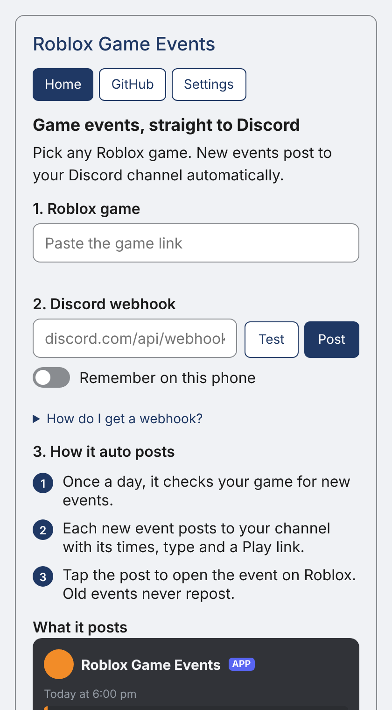
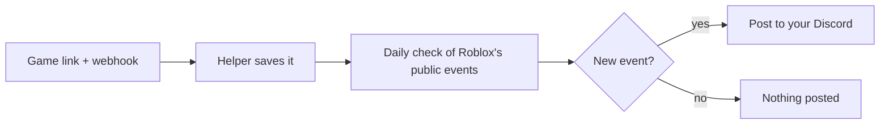

# Roblox Game Events

**Any Roblox game's events, posted to your Discord.**

[**Open the site**](https://roblox-game-events.pages.dev) · [Stay safe](https://roblox-game-events.pages.dev/safety.html) · [How it compares](developer/COMPARISON.md)

## Set up
> [!TIP]
> **2 minutes, works on a phone**
> 1. In Discord: channel settings → **Integrations** → **Webhooks** → **New Webhook** → **Copy Webhook URL**.
> 2. Open [roblox-game-events.pages.dev](https://roblox-game-events.pages.dev).
> 3. Paste the game link and the webhook.
> 4. Tap **Turn on**. It posts "Now following" plus the events running now.

## Buttons
| Button | What it does |
|---|---|
| **Turn on** | Follows the game. New events post once a day. |
| **Turn off** | Stops posts and deletes the game and webhook from the helper. |
| **Post again** | Reposts the current events (once every 10 minutes). |

## How it works

## Good to know
> [!NOTE]
> - **No spam:** each event posts once, at most 3 a day.
> - **Limit:** one channel can follow up to 5 games.
> - **Depends on Roblox:** uses its public events list. If Roblox changes it, posts stop.

> [!WARNING]
> - **Keep your webhook secret.** Anyone with it can post in your channel.
> - **Turn on saves your game and webhook** on the helper so it can post. [Read the risks](https://roblox-game-events.pages.dev/safety.html#risk).
