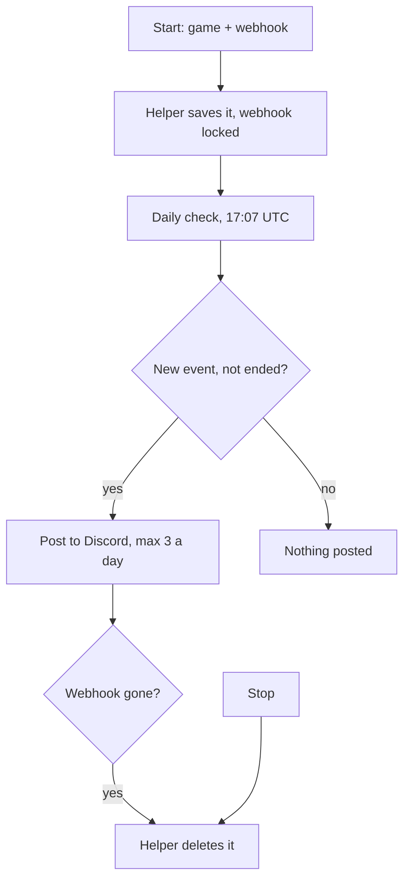

# How it works

1. **Start** saves the game and webhook on the helper (a small Cloudflare service). The webhook is stored locked (encrypted). Events the game already has are noted.
2. **Once a day** (17:07 UTC) a GitHub job asks the helper to check every followed game.
3. The helper reads the game's public event list from Roblox.
4. Any event it hasn't seen before, and that hasn't ended, gets posted. Max 3 a day per game.
5. If Discord says the webhook is gone, the helper deletes that game and webhook by itself.

No Roblox login is used. Only Roblox's public events list.

---

[← The post](The-post) · [Home](Home) · [Limits →](Limits)

